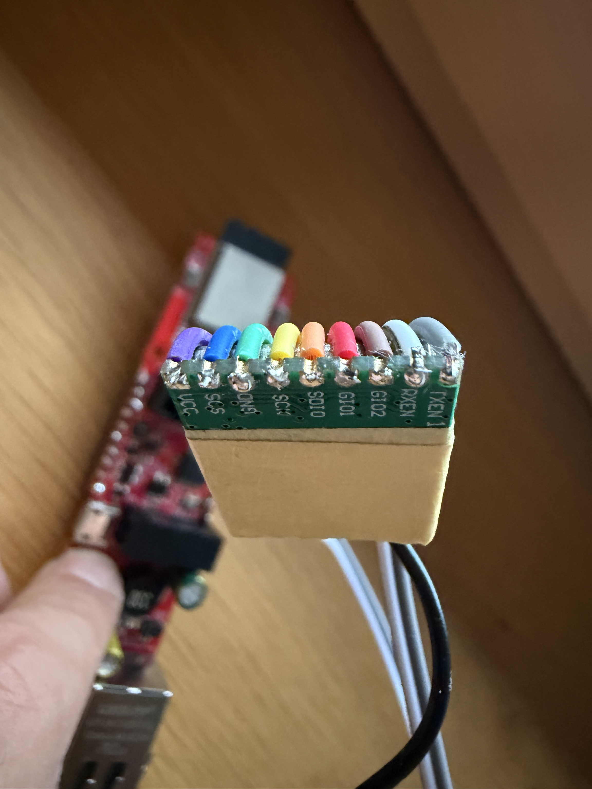
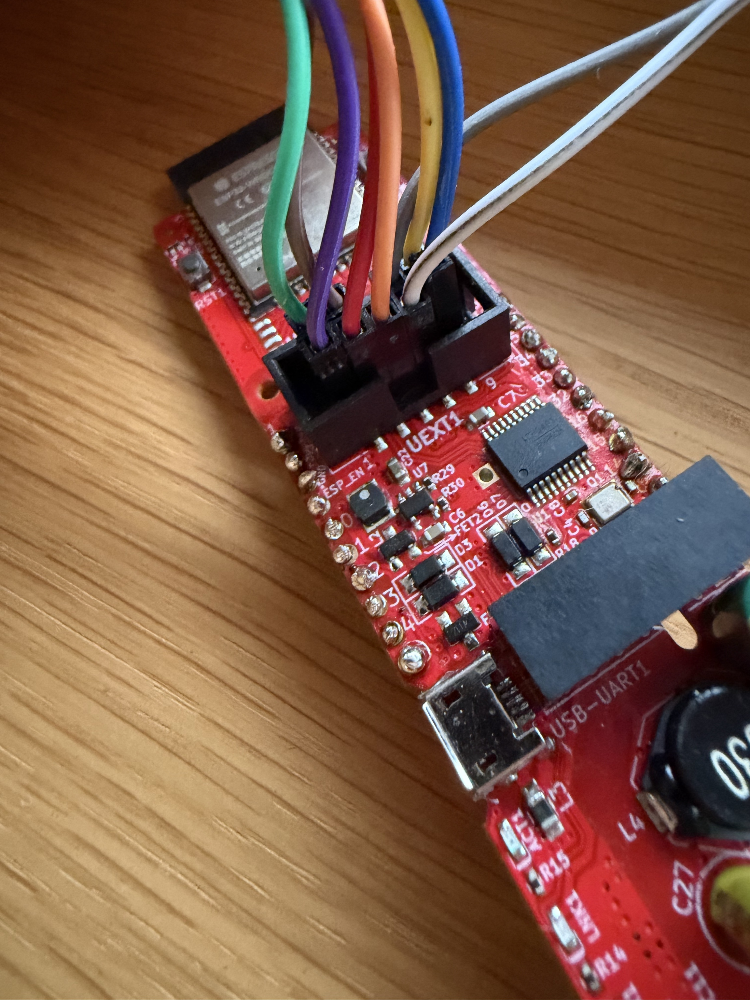

# TR245A-Ventilator mit ESPHome

Info: Text von AI überarbeitet und Code vollständig durch AI erstellt.

Lange hat's gedauert, aber jetzt hab ich mich am Wochenende hingesetzt und kann meinen
Deckenventilator **CasaFan Eco Genuino 152 MW-EM** mit TR245A-Fernbedienung über Home Assistant
steuern und die Originalfernbedienung weiter benutzen. Dafür habe ich
das Funksignal untersucht und Codex hat eine Steuerung mit ESP32 und A7105-Funkmodul
daraus gebaut. Bei mir läuft sie inzwischen seit mehreren Wochen zuverlässig.

## Vom Funksignal zur Steuerung

Mit einem HackRF habe ich ca. 50 Samples von Tastendrücken aufgenommen. Die Aufnahmen
habe ich mit Universal Radio Hacker (URH) ausgewertet und die Bitfolgen miteinander
verglichen. Wegen viel Rauschen und WLAN-Störungen habe ich erstmal wenig gesehen :)

Ein ESP32 mit A7105 als Sender und Empfänger kam nach Recherche und auf Vorschlag
von Claude dazu, um die Pakete der
Originalfernbedienung zu empfangen und eigene Befehle am Ventilator zu testen.
Nachdem das Signal dekodiert und das Paketformat bekannt war, hat Codex
den funktionsfähigen ESP32-Sketch und den Treiber für ESPHome geschrieben.
Am Anfang hat der Empfänger nach ein paar Stunden seinen Betrieb eingestellt,
aber nach einigen Korrekturen war das auch behoben.

Damit lassen sich sechs Geschwindigkeitsstufen, Ausschalten und Drehrichtung
bedienen. Empfangene Befehle der Originalfernbedienung aktualisieren auch die
Anzeige in Home Assistant – top! Eine Rückmeldung über den tatsächlichen
Motorzustand gibt es dabei nicht. Eine Idee wäre, den ESP um ein Mikrofon zu
erweitern, das den Piepton des Ventilators als akustische Bestätigung erkennt.
Das ist bisher nicht umgesetzt.

## Hardware und Verdrahtung

Die **TR245A** ist laut [FCC-Prüfbericht](https://fccid.io/KUJCE11001/Test-Report/Test-Report-5300909)
eine Fernbedienung von **Chungear Industrial Co., Ltd.** Die Kennungen lauten
**FCC ID: KUJCE11001** und **IC: 10786A-TR245A**
([Anleitung](https://fccid.io/KUJCE11001/User-Manual/User-Manual-5300911)).

In der TR245A-Fernbedienung steckt ein **AMICCOM A8105**. Er enthält einen
8051-Mikrocontroller und den 2,4-GHz-Funkteil in einem Chip
([Herstellerbeschreibung](https://www.amiccom.com/asp_en/product_detail.asp?CATG_ID=15&PRODUCT_ID=84)).

Für meine Steuerung verwende ich einen **Olimex ESP32-PoE-ISO** mit Ethernet
und ein **XL7105-D03-Funkmodul** von AliExpress.

So ist das Modul bei mir am UEXT-Anschluss des Olimex verdrahtet:




Die zusätzliche Leitung an GIO1 auf dem Foto wird vom FIFO-Treiber nicht verwendet.

| Anschluss am XL7105-D03 | Anschluss am Olimex | Aufgabe |
|---|---|---|
| VCC | 3,3 V | Versorgung des Funkmoduls |
| GND | GND | Gemeinsame Masse |
| SCS / CS | GPIO14 | SPI-Chip-Select |
| SCK | GPIO5 | SPI-Takt |
| SDIO | GPIO16 | MOSI: Daten vom ESP32 zum A7105 |
| GIO2 / SDO | GPIO36 | MISO: Daten vom A7105 zum ESP32 |
| TXEN | GPIO2 | Zusammen mit RXEN: Umschaltung Senden/Empfangen |
| RXEN | GPIO15 | Zusammen mit TXEN: Umschaltung Senden/Empfangen |
| GIO1 | — | Im verwendeten FIFO-Betrieb nicht benötigt |

TXEN und RXEN entsprechen den Beschriftungen am Modul. Die passende Ansteuerung
übernimmt die Einstellung `front_end: XL7105_D03` in der YAML-Datei.

## Signal und Dekodierung

| Eigenschaft | Wert |
|---|---|
| Frequenz | 2410 MHz |
| Modulation | binäre FSK |
| Datenrate | 500 kbit/s |
| Paketlänge | 17 Bytes / 136 Bits einschließlich Präambel und CRC |
| Normaler Tastendruck | 11 gleiche Pakete, Abstand der Paketanfänge etwa 4,876 ms |

Die beiden Frequenzlagen werden als 0 und 1 gelesen, das höherwertige Bit
kommt zuerst (MSB first). Bei 500 kbit/s dauert ein Bit 2 µs. Zum Dekodieren
werden die demodulierten Bits anhand der wiederkehrenden Präambel und des
Zugriffscodes ausgerichtet und anschließend in Bytes aufgeteilt:

```text
55 55 55 55 | 54 75 C5 2A | AH AL | CMD | VAL | SUM | 00 80 | CRC16
```

Die Bytepositionen sind ab null gezählt:

| Bytes | Inhalt | Bedeutung |
|---|---|---|
| 0–3 | `55 55 55 55` | Präambel zur Synchronisation |
| 4–7 | `54 75 C5 2A` | Fester Zugriffscode zur Paketerkennung |
| 8–9 | `AH AL` | Adresse, höherwertiges Byte zuerst; `00 00` im Universalmodus |
| 10 | `CMD` | Befehl |
| 11 | `VAL` | Wert zum Befehl |
| 12 | `SUM` | Summe aus Adresse, Befehl und Wert: `(AH + AL + CMD + VAL) & 0xFF` |
| 13–14 | `00 80` | In den ausgewerteten Paketen konstant; Bedeutung der einzelnen Bits noch unbekannt |
| 15–16 | `CRC16` | CRC über die sieben Bytes 8–14, höherwertiges Byte zuerst |

Die CRC ist **CRC-16/SPI-FUJITSU**, auch AUG-CCITT genannt: Polynom `0x1021`,
Startwert `0x1D0F`, keine Bitspiegelung und kein abschließendes XOR. Beim
Empfang prüft der Treiber sowohl die CRC als auch die einfache Summe.

### Verwendete Befehle

Alle Werte in der Tabelle sind hexadezimal:

| Funktion | CMD | VAL |
|---|---|---|
| Ausschalten | `00` | `00` |
| Geschwindigkeit setzen | `10` | `01` bis `06` |
| Drehrichtung umschalten | `20` | `01` |

UP und DOWN senden bereits eine absolute Stufe. Der Funkwert ist
`7 − Stufe`, wobei Stufe 1 langsam und Stufe 6 schnell ist. Der
Richtungsbefehl schaltet die Richtung um, enthält aber keine absolute
Zielrichtung.

Ein vollständiges Paket für **Stufe 3 im Universalmodus** sieht so aus:

```text
55 55 55 55 | 54 75 C5 2A | 00 00 | 10 | 04 | 14 | 00 80 | D8 F2
```

`04` steht für Stufe 3, `14` ist die Summe und `D8 F2` die CRC. Präambel und
Zugriffscode erzeugt der A7105 selbst. Der Treiber schreibt die sieben
Nutzbytes samt den zwei berechneten CRC-Bytes in den Hardware-FIFO.

## DIP-Schalter und Universalmodus

Die genaue Wirkung aller Kombinationen der beiden DIP-Schalter im Batterieschacht
auf das Protokoll ist noch nicht vollständig dekodiert. Die
SET-/Anlerntaste habe ich nicht verwendet, da ich den Ventilator ausschließlich
im Universalmodus betreibe. Dafür wird die Adresse `0x0000` verwendet.

## ESPHome verwenden

Als Basis verwende ich die
[offizielle Bluetooth-Proxy-Konfiguration für den Olimex ESP32-PoE-ISO](https://github.com/esphome/bluetooth-proxies/blob/main/olimex/olimex-esp32-poe-iso.yaml).
[tr245a-fan.yaml](tr245a-fan.yaml) ergänzt diese um SPI, Funkmodul, Ventilator
und Richtungstaste.

Den Ordner `components/tr245a` in dein ESPHome-Konfigurationsverzeichnis kopieren
(im Home-Assistant-Add-on normalerweise `/config/esphome/`). Die Datei
`tr245a-fan.yaml` dort unter `packages/tr245a-fan.yaml` ablegen.
Dann im bestehenden `packages:`-Abschnitt diese Zeile ergänzen:

```yaml
  tr245a: !include packages/tr245a-fan.yaml
```
